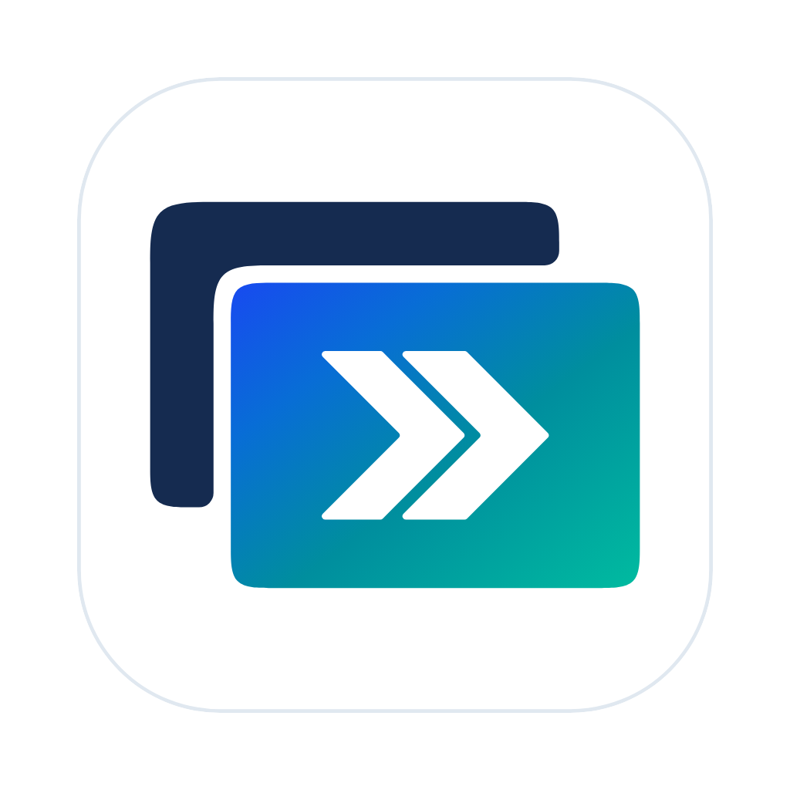

<p align="center">
  
</p>

<h1 align="center">Shellkite</h1>
<p align="center">Remote desktop for Mac.</p>

Share a Mac’s display and control it from another Mac or a browser on a computer, phone, or tablet. Shellkite streams video and audio over WebRTC, with end-to-end encryption and a relay when a direct connection isn’t available.

## Connect to a Mac

1. On the Mac you want to control, open Shellkite and choose **Access this Mac remotely**.
2. Allow **Screen Recording** and **Accessibility**, then select **Start sharing**.
3. Open the connection link on your other device, or scan the QR code with a phone or tablet. The link opens the [Shellkite web viewer](https://shellkite.xpromptvs.com/app).

To find a shared Mac from the native app, sign in with the same passkey on both Macs and choose **Connect to another Mac**.

## Build from source

You’ll need an Apple Silicon Mac running macOS 26 or later, Xcode command-line tools, Node.js 20.19 or later, Bazelisk, and CMake.

```sh
git submodule update --init --depth 1
npm --prefix protocol ci
npm --prefix web ci
npm --prefix desktop ci
npm --prefix desktop run build:check
open "desktop/release-check/Shellkite Development.app"
```

The development build uses a separate app identity. Native passkey sign-in requires a signed build with Shellkite’s Associated Domains entitlement. See [build and signing instructions](docs/building.md) and [test instructions](docs/testing.md).

## Deploy the viewer

```sh
RDEV_PRODUCT_PROFILE=publication RDEV_RELEASE_CHANNEL=public npm --prefix web run build
wrangler deploy --config wrangler.viewer.jsonc
```

Shellkite is a desktop-only fork of [Xpromptvs](https://github.com/xpromptvs/xpromptvs) and uses its shared connection service. See [architecture](docs/architecture.md) for details.

[MIT License](LICENSE) © Spectral Gardens. [Third-party notices](THIRD_PARTY_NOTICES.md).
